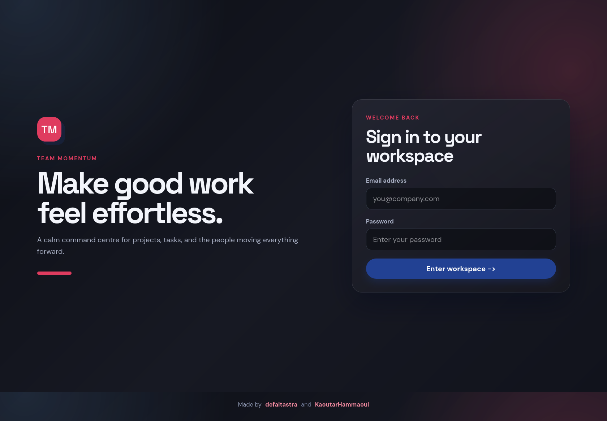

# TeamPulse

🚀 **Live Demo:** [https://teampulse-1.netlify.app/](https://teampulse-1.netlify.app/)

A focused project and task workspace for teams who want their next step to stay visible.



## About

TeamPulse is a full-stack task manager. Users sign up, create projects, and break each project down into tasks with a status, priority, and due date. Every user only sees their own work, while admins can view and manage everything.

## Features

- **Authentication**: register and log in with bcrypt-hashed passwords and JWT tokens
- **Projects**: create, view, edit, and delete projects
- **Tasks**: full CRUD per project, with status (`todo`, `in_progress`, `done`), priority (`low`, `medium`, `high`), and due date
- **Filtering and pagination**: filter tasks by status and page through long lists
- **Roles**: regular users are scoped to their own data; admins can access all projects and tasks and promote or demote other users
- **Protected routes**: both the API (auth middleware) and the frontend (route guard) require a valid session

## Built with

- **Frontend:** React, TypeScript, Vite, React Router
- **Backend:** Go, chi router, JWT, bcrypt
- **Database:** SQLite

## Run locally

**1. Set up the database** (from the project root):

```bash
sqlite3 app.db < schema.sql
```

**2. Configure the API.** Create `api/.env`:

```
JWT_SECRET=your-long-random-secret
```

**3. Start the API:**

```bash
cd api
go run .
```

**4. Start the frontend** in a second terminal:

```bash
cd frontend
npm install
npm run dev
```

The API runs on `http://localhost:8080` and Vite serves the frontend at the URL shown in the terminal.

> New accounts are created with the `user` role. To create the first admin, update the role directly in the database:
> `UPDATE users SET role = 'admin' WHERE id = 1;`

## API overview

| Area | Endpoints |
|---|---|
| Auth | `POST /register`, `POST /login`, `GET /me` |
| Projects | `POST /CreateProject`, `GET /GetProjects`, `GET /GetProject/{id}`, `PATCH /UpdateProject/{id}`, `DELETE /DeleteProject/{id}` |
| Tasks | `POST /AddTask`, `GET /GetTasks?project_id=`, `GET /tasks/{id}`, `PATCH /UpdateTask/{id}`, `DELETE /DeleteTask/{id}` |
| Admin | `PATCH /UpdateUserRole/{id}` |

All routes except `/register` and `/login` require an `Authorization: Bearer <token>` header.

## Thanks

Special thanks to [@defaltastra](https://github.com/defaltastra) for his work on the project.